<picture>
  <source media="(prefers-color-scheme: dark)" srcset="assets/banner-dark.svg">
  <source media="(prefers-color-scheme: light)" srcset="assets/banner-light.svg">
  
</picture>

Backend engineer for companies in EMEA and the Americas. Six years of Java and Spring Boot across telecom, iGaming and banking integrations: I modernise legacy services without losing the business logic inside them, and build the pipelines and monitoring that keep them running.

[Website](https://stjepanmamusa.com) · [Case studies](https://stjepanmamusa.com/work/) · [Work with me](https://stjepanmamusa.com/work-with-me/) · [CV](https://stjepanmamusa.com/cv/) · [LinkedIn](https://www.linkedin.com/in/stjepanmamusa/) · [Email](mailto:mamusa.stjepan@borac.dev)

### Organisations

- **[Borac Development](https://github.com/Borac-Development)** ([borac.dev](https://borac.dev)): my sole proprietorship for B2B contracts, plus open-source and education projects.
- **[SOSS](https://github.com/soss-stem)**: a volunteer-led organisation I founded at the University Department of Professional Studies in Split to share software with colleagues and professors.

*Rest here, weary traveler.*
